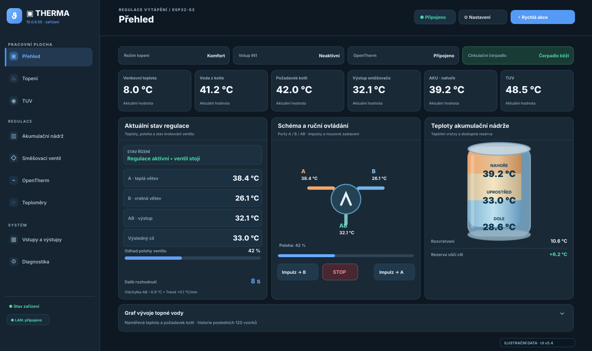
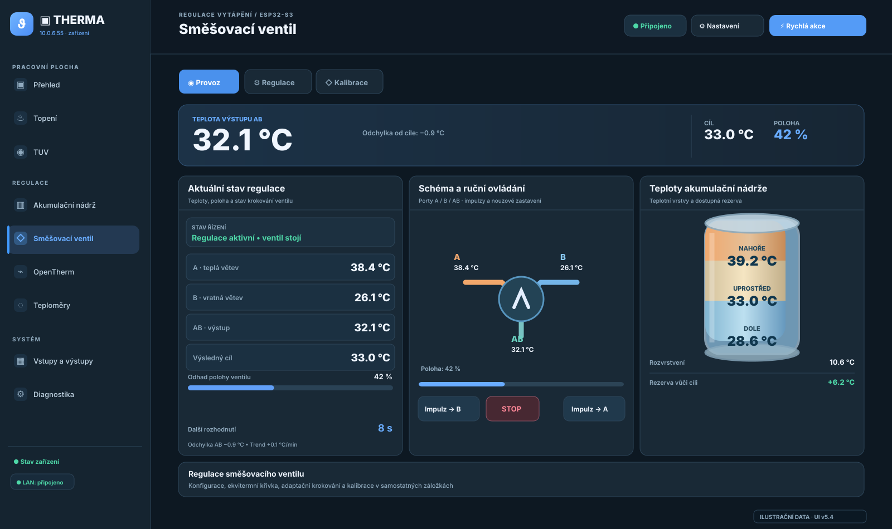
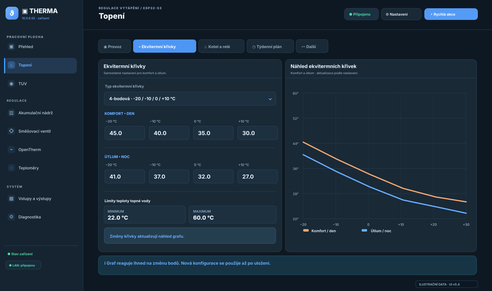

# THERMA · ESP32-S3 · Řízení vytápění, OpenTherm a směšovacího ventilu

[](https://www.espressif.com/en/products/socs/esp32-s3)
[](https://www.home-assistant.io/integrations/mqtt/)
[](LICENSE)

Firmware pro **Waveshare ESP32-S3-ETH-8DI-8RO**, určený k řízení topného systému, akumulační nádrže, TUV, 3cestného směšovacího ventilu a komunikace s kotlem přes OpenTherm. Obsahuje živé webové UI THERMA, ekvitermní regulaci, senzory DS18B20 a BLE, MQTT/Home Assistant a trvalou provozní diagnostiku.

> **Stav ověření:** README popisuje připravený zdrojový kód na této větvi. Změny MQTT a alarmového buzzeru vyžadují kompilaci a hardwarové ověření. Výrobní nasazení do topné soustavy provádějte až po kontrole bezpečných stavů relé, správných směrů ventilu a vypínání při poruchách.

## Náhledy aktuálního webového UI THERMA

Ukázky níže vycházejí z **aktuální struktury webového rozhraní v5.4**, nikoliv ze starého designu `web-winter-*.webp`. Jsou to **ilustrační náhledy připravené podle HTML/CSS/JS projektu**, s demonstračními teplotami a stavy. Nejde o skutečné screenshoty živého zařízení ESP32.

### Přehled – provozní panel

Stav vytápění, venkovní teplota, kotel, TUV a **trojice provozních karet směšovače**: aktuální stav regulace, schéma ručního ovládání a teplotní vrstvy AKU.



### Směšovací ventil – provoz

Aktuální poloha a teploty ventilových portů A/B/AB, doba do dalšího regulačního rozhodnutí, ruční impulzy a teplotní nádrž. Konfigurace regulace a kalibrace jsou v samostatných záložkách.



### Topení – ekvitermní křivky

Editor **2bodové a 4bodové ekvitermní křivky** (komfort/útlum), limity topné vody a graf s náhledem obou křivek. Náhled reaguje na změny formuláře; nové nastavení se použije až po uložení.



> **Poznámka:** Pro autentické screenshoty se skutečnými naměřenými hodnotami je potřeba otevřít webové UI běžícího zařízení ESP32 a zachytit příslušné stránky. Staré snímky `web-winter-*.webp` zůstávají v repozitáři pouze pro historickou referenci.

## Funkce

| Oblast | Podpora |
|---|---|
| Hardware | ESP32-S3, Ethernet + Wi-Fi, 8 digitálních vstupů a 8 relé (TCA9554) |
| OpenTherm | Telemetrie kotle, požadavky CH/TUV, diagnostika Data-ID a scan |
| Ekviterm | 2bodová / 4bodová křivka, komfort / útlum, limity, časový plán |
| Směšovací ventil | Automatická regulace A/B/AB, impulzy, odhad polohy, interlock R1/R2, ruční STOP |
| Akumulační nádrž | Teploty nahoře / uprostřed / dole, sledování teplotní rezervy |
| TUV | Ohřev, cirkulace, plánovač, pulzní cirkulace, anti-legionella |
| Teploměry | 1-Wire DS18B20; BLE venkovní meteorologický senzor |
| Web | Responzivní přehled, konfigurace, grafy, živá komunikace přes WebSocket a HTTP fallback |
| Integrace | MQTT state, availability, auto-discovery Home Assistant |
| Provoz | OTA, watchdog telemetrie, sledování OT timeoutů, LittleFS diagnostický žurnál |
| Signalizace | Startovní pípnutí a opakované alarmové **beep–pauza–beep** pro tlakové alarmy |

## Hardware a připojení

Základní konfigurace pinů je v `config_pins.h`:

| Funkce | GPIO / rozhraní |
|---|---|
| Digitální vstupy IN1–IN8 | GPIO4–11 |
| Relé R1–R8 | I²C expander TCA9554 |
| I²C | SDA GPIO42, SCL GPIO41 |
| OpenTherm | TX GPIO47, RX GPIO48 |
| DS18B20 (4 sběrnice) | GPIO0, GPIO1, GPIO2, GPIO3 |
| Pasivní buzzer | GPIO46, LEDC PWM 2 kHz |
| RGB LED | GPIO38 |

Výchozí role DS18B20: GPIO0 porty směšovače A/B/AB, GPIO3 horní/střední/spodní AKU, GPIO2 zpátečka, GPIO1 zpátečka cirkulace TUV. Role konkrétních čidel se přiřazují v konfiguraci.

**Pozor:** R1 a R2 jsou vyhrazeny výhradně směšovacímu ventilu. Nepřepínejte je přímo z MQTT, servisních skriptů ani Home Assistantu. Před propojením s kotlem ověřte kompatibilitu a izolaci adaptéru OpenTherm.

## Webové rozhraní a API

UI se nachází v `data/` a při běžném provozu se načítá z **LittleFS**:

- `data/index.html` – hlavní aplikace a formuláře;
- `data/app.js` – komunikace API a WS, řízení formulářů, grafy;
- `data/ui-v5.js`, `data/ui-v5.css` – nové uspořádání a styl.

WebSocket typicky přináší průběžná data přibližně každou sekundu. Při výpadku používá UI HTTP fallback. Konfigurace se ukládá do NVS; souborový systém má také záložní konfiguraci `/config.json`.

Příklady API: `/api/fast`, `/api/bootstrap`, `/api/mixing/status`, `/api/equitherm/status`, `/api/opentherm/status`, `/api/mqtt/status`, `/api/diagnostics/status`. Lokální servisní API nevystavujte přímo do veřejného internetu.

## MQTT / Home Assistant (HAOS / HASSIO)

Nastavení najdete ve **webovém UI → Diagnostika → MQTT + Home Assistant**. Zadejte adresu a port brokeru, přihlašovací údaje (pokud jsou potřeba), zapněte MQTT a `Home Assistant` + `MQTT Discovery`, uložte konfiguraci.

Zařízení používá témata v následujícím tvaru (výchozí `baseTopic=esp32-controller`):

| Téma | Obsah |
|---|---|
| `esp32-controller/state` | Jeden JSON snímek provozních hodnot (retained) |
| `esp32-controller/availability` | `online` / `offline` (retained, LWT) |
| `esp32-controller/info` | Základní informace o zařízení |
| `esp32-controller/cmd/#` | Podporované servisní a uživatelské příkazy |
| `homeassistant/<component>/<nodeId>/<entity>/config` | Retained MQTT Discovery |

### Automaticky zveřejňované hodnoty

Kód vystavuje jako MQTT JSON a/nebo HA Discovery zejména:

- **Teploty:** venkovní, přívod, zpátečka, zásobník TUV, zpátečka TUV a tři vrstvy AKU.
- **Směšovací ventil:** poloha, teploty A/B/AB, cílová a základní teplota, regulační odchylka, trend, feed-forward, směr pohybu, čas do dalšího rozhodnutí, zbývající impulz a stav regulace.
- **OpenTherm:** stav linky, plamen, aktivní vytápění/TUV, teploty kotle/zpátečky/TUV/venkovní/pokojové, požadavky setpointů, tlak, modulace a výkon; další hodnoty jsou přítomné v MQTT JSON i pokud pro ně není vytvořena samostatná entita HA.
- **Ekviterm:** vypočtené cíle, režim, stav a důvod regulace.
- **TUV:** požadavek a aktivní ohřev, teplota/cíl, cirkulace, fáze a anti-legionella.
- **Alarm tlaku:** aktivní / nízký / vysoký tlak a aktuální hodnota.
- **Systém:** ethernet/Wi-Fi, relé R3–R8 jako přepínače, všech 8 vstupů jako binární senzory, RAM a doba provozu, BLE vlhkost/tlak.

**Rozlišení:** MQTT JSON obsahuje více položek než autodetekce jednotlivých entit; předchozí implementace publikovala jen zhruba deset číselných senzorů a několik přepínačů. Tento update významně rozšiřuje pokrytí, ale **nepřevádí automaticky všechna pole komplexních stavových objektů na samostatné HA entity**. Nedostupné fyzické hodnoty mohou být `null`.

### Příkazy (příklad)

```text
esp32-controller/cmd/equitherm/mode/set  auto|day|night
esp32-controller/cmd/dhw/circ/set       ON|OFF
esp32-controller/cmd/dhw/heat/set       ON|OFF|BOOST
esp32-controller/cmd/mix/pulse/set      A|B|STOP
esp32-controller/cmd/relay/3/set       ON|OFF|TOGGLE
```

**Bezpečnost:** příkazy mohou ovlivnit topnou soustavu. Zajistěte autentizaci brokeru, omezení oprávnění MQTT témat a oddělení sítě. HA entity relé R1/R2 se výslovně nepublikují.

### Kontrola při problému s Discovery

1. Ověřte funkčnost MQTT brokeru v HAOS a logy integrace MQTT.
2. Zkontrolujte `/api/mqtt/status`: `connected`, `discoveryPublished`, `discoveryQueued`, `discoveryFailed`.
3. Projděte retained témata `homeassistant/#` a `esp32-controller/state`. `discoveryPublished` znamená úspěšné zařazení publikací do MQTT klienta, nikoli potvrzení, že se každá entita vytvořila v HA.
4. Při přejmenování `nodeId` mohou staré retained discovery entity zůstat v brokeru; vyčistěte je cíleně.

## Akustický alarm (buzzer)

`BuzzerController` používá LEDC na **GPIO46 / 2 kHz**. Při startu zazní jednorázový krátký signál.

Při aktivním alarmu tlaku následuje cyklický vzor:

| Krok | Délka |
|---|---:|
| Beep | 450 ms |
| Pauza | 200 ms |
| Beep | 450 ms |
| Pauza mezi cykly | 900 ms |

Signalizace končí po odeznění nebo vypnutí alarmu. Oprava brání resetování zvukového vzoru v každém průchodu `pressureAlarmLoop()`; díky tomu se provede skutečně **beep–pauza–beep**, nikoli nepřerušený tón.

Tlakový alarm porovnává platnou hodnotu tlaku získanou přes OpenTherm s limity a hysterezí. **Neplatné nebo nedostupné tlakové čidlo samo o sobě nespouští akustický tlakový alarm**; stav je `sensor_invalid`. Signál lze servisně otestovat přes `/api/service/io` (povel buzzer warning/off).

## Diagnostika a LittleFS

`DeviceDiagnostics.cpp/.h` ukládá JSONL události do `/diagnostics/events.jsonl`, s rotací archivů. Zaznamenává příčiny restartu, pomalé části hlavní smyčky, chyby OpenTherm, změny sítě/WS a stav RAM. V UI otevřete **Diagnostika → Logy**; další informace: [Trvalá diagnostika](docs/PERSISTENT_DIAGNOSTICS.md).

Při selhání připojení LittleFS se diagnostické soubory záměrně **automaticky nemažou/formátováním**.

## Instalace a aktualizace

1. Stáhněte repozitář a otevřete `ESP32-S3-ETH-8DI-8RO-Controller.ino` ve správně nakonfigurovaném Arduino IDE s balíčkem ESP32-S3 a požadovanými knihovnami.
2. Zkontrolujte `config_pins.h`, připojení OpenTherm a přiřazení čidel.
3. Nahrajte **firmware** a obsah složky **`data/`** do LittleFS, aby webové UI odpovídalo firmware.
4. Ve webovém UI nakonfigurujte síť, OpenTherm, ekvitermní křivky, směšovač a TUV.
5. Ověřte zachování konfigurace po restartu a chování v případě odpojení kotle/senzorů.
6. Před připojením k reálné soustavě proveďte kontrolu výstupů a test bezpečných stavů.

Aktualizace přes OTA / webové UI je podporována podle nastavení zařízení a rozdělení flash paměti. Vyvarujte se přerušení napájení během zápisu firmware či filesystemu.

## Projektová struktura

```text
ESP32-S3-ETH-8DI-8RO-Controller.ino   hlavní smyčka
ConfigStore.* / ConfigRuntime.*      NVS a runtime konfigurace
OpenTherm* / OTBusESP32Pro.*          OpenTherm transport a stav kotle
EquithermController.*                2/4bodové topné křivky
MixingValveController.*              řízení směšovacího ventilu
DhwController.*                       ohřev TUV a cirkulace
TemperatureManager.* / Dallas*       centrální registry čidel
MqttController.*                      MQTT a HA Discovery
BuzzerController.*                    zvuková signalizace
PressureAlarmController.*             tlakové alarmy
DeviceDiagnostics.* / EventLog.*     provozní diagnostika
WebPortalController.*                 HTTP API a WebSocket
data/                                  webová aplikace a LittleFS
docs/screenshots/                     náhledy UI
```

## Licence

[MIT](LICENSE). Projekt je zaměřen na zkušené techniky a vývojáře; nejsou tím nahrazeny nezávislé bezpečnostní ochrany kotle, tlakové soustavy nebo elektroinstalace.
